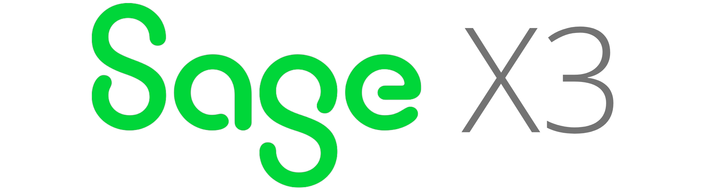

<b>English</b> · <a href="./README.pt-BR.md">Português</a>

<h1 align="center">Hi there 👋, I'm Richard Ikeda</h1>
<h3 align="center">Solutions Architect · Sage X3 · ERP Integrations</h3>

## About me

I'm the founder of [EnterScript](https://enterscript.com/), where I work on the architecture, development and integration of ERP solutions, with a focus on Sage X3. I enjoy translating business processes and technical requirements into practical software.

My experience includes projects in Brazil, Portugal, Canada, Peru and Argentina, working with ERP integrations and business and regulatory requirements across different contexts. You can find more of my professional background on [LinkedIn](https://linkedin.com/in/richardikeda).

## What I work on

- **Sage X3 and 4GL:** developing and extending ERP routines and tools.
- **ERP integrations:** connecting business and financial processes with external systems and services.
- **Tax and regulatory requirements:** adapting ERP processes to requirements such as Brazilian NF-e, NFS-e and SPED.
- **International environments:** evolving systems across different business and regulatory contexts.
- **AI-assisted work:** exploring AI tools and gateways to support development, integrations and process optimization.

## Featured projects

### 4GL Studio Plugin for VS Code

An independent Visual Studio Code extension in development for Sage X3 4GL. It brings together language editing support, X3 connectivity, source synchronization and compilation. Debugging support is experimental, and further validation is in progress before a public release.

The earlier [Non Official X3 Language Support for IntelliJ IDEA](https://github.com/richardikeda/nox3-language-plugin) was part of this journey and helped inform the VS Code project.

### [SPEX — Secure Permissioned Exchange](https://github.com/richardikeda/SPEX)

An open-source messaging and transport protocol focused on explicit permissions and end-to-end encryption. The repository contains protocol components, a client SDK and a reference CLI, along with documentation and release controls. The project continues to evolve.

### [Better Player](https://github.com/richardikeda/better-player-public)

A browser extension for Instagram video controls, including playback speed, volume and repetition. Its public repository brings together installation, support and privacy information.

### [Postal Pet](https://github.com/richardikeda/postal-pet)

A Minecraft Fabric mod that adds pet mailboxes, home links and home ranges. The project is available as a beta and includes documentation and screenshots.

## Skills & tools

My work spans ERP development, integrations and a range of tools I use or have explored. The icons below reflect that breadth; they are not a ranking of proficiency.

  
                     

## Exploring & creating

I'm currently exploring how AI-assisted workflows can help me develop software, analyze systems and optimize processes, while continuing to work on ERP integrations and developer tools.

I also share technology and business content through [EnterScript](https://enterscript.com/).

## Let's connect

I'm open to conversations about Sage X3, ERP integrations, software projects and collaboration.

   

- International contact: [mzhe6xb4h@mozmail.com](mailto:mzhe6xb4h@mozmail.com)

## GitHub activity

 

## For fun 🎵

