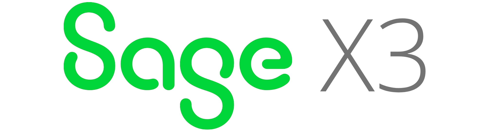

<a href="./README.md">English</a> · <b>Português</b>

<h1 align="center">Olá 👋, sou Richard Ikeda</h1>
<h3 align="center">Arquiteto de Soluções · Sage X3 · Integrações ERP</h3>

## Sobre mim

Sou fundador da [EnterScript](https://enterscript.com/) e trabalho com arquitetura, desenvolvimento e integração de soluções ERP, com foco em Sage X3. Gosto de transformar processos de negócio e requisitos técnicos em soluções de software práticas.

Minha experiência inclui projetos no Brasil, em Portugal, no Canadá, no Peru e na Argentina, envolvendo integrações de ERP e requisitos de negócio e legislação em diferentes contextos. Você encontra mais detalhes da minha trajetória no [LinkedIn](https://linkedin.com/in/richardikeda).

## Áreas de atuação

- **Sage X3 e 4GL:** desenvolvimento e extensão de rotinas e ferramentas para ERP.
- **Integrações de ERP:** conexão de processos de negócio e financeiros a sistemas e serviços externos.
- **Requisitos fiscais e regulatórios:** adaptação de processos de ERP a exigências como NF-e, NFS-e e SPED no Brasil.
- **Ambientes internacionais:** evolução de sistemas em diferentes contextos de negócio e legislação.
- **Trabalho com apoio de IA:** exploração de ferramentas e gateways de IA para apoiar desenvolvimento, integrações e otimização de processos.

## Projetos em destaque

### 4GL Studio Plugin para VS Code

Uma extensão independente em desenvolvimento para trabalhar com Sage X3 4GL no Visual Studio Code. Reúne suporte à edição da linguagem, conexão com o X3, sincronização de fontes e compilação. O suporte a depuração é experimental e ainda há validações em andamento antes de uma publicação pública.

O projeto anterior, [Non Official X3 Language Support para IntelliJ IDEA](https://github.com/richardikeda/nox3-language-plugin), fez parte dessa trajetória e contribuiu para o projeto no VS Code.

### [SPEX — Secure Permissioned Exchange](https://github.com/richardikeda/SPEX)

Protocolo de código aberto para mensagens e transporte, com foco em permissões explícitas e criptografia de ponta a ponta. O repositório reúne componentes do protocolo, um SDK para clientes e uma CLI de referência, além de documentação e controles de lançamento. O projeto segue em evolução.

### [Better Player](https://github.com/richardikeda/better-player-public)

Extensão de navegador para controlar vídeos do Instagram, incluindo velocidade, volume e repetição. Seu repositório público reúne informações de instalação, suporte e privacidade.

### [Postal Pet](https://github.com/richardikeda/postal-pet)

Mod Fabric para Minecraft que adiciona caixas de correio para pets, vínculos com suas casas e áreas de permanência. O projeto está disponível em beta e inclui documentação e imagens.

## Tecnologias e ferramentas

Meu trabalho envolve desenvolvimento de ERP, integrações e diversas ferramentas que utilizo ou já explorei. Os ícones representam essa variedade e não uma classificação de domínio.

  
                     

## Explorando e criando

Atualmente exploro como fluxos de trabalho com apoio de IA podem me ajudar a desenvolver software, analisar sistemas e otimizar processos, enquanto continuo trabalhando em integrações de ERP e ferramentas para desenvolvedores.

Também compartilho conteúdos sobre tecnologia e negócios pela [EnterScript](https://enterscript.com/).

## Vamos conversar

Estou aberto a conversas sobre Sage X3, integrações de ERP, projetos de software e colaboração.

   

- Contato internacional: [mzhe6xb4h@mozmail.com](mailto:mzhe6xb4h@mozmail.com)

## Atividade no GitHub

 

## Para descontrair 🎵

